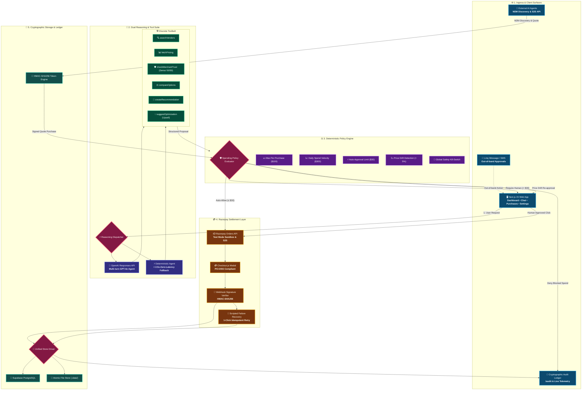
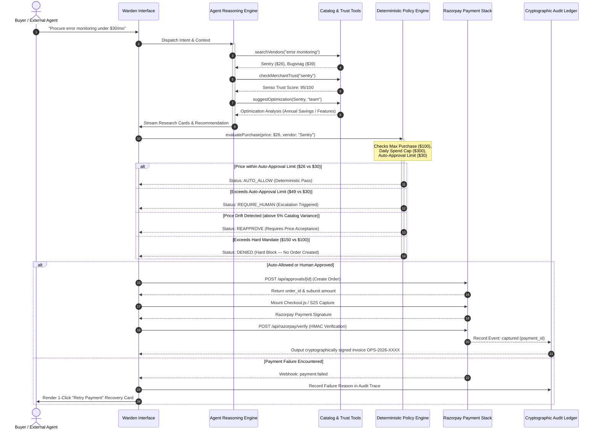

# Warden

<div align="center">

**Bounded, gated, autonomous commerce for AI agents.**

*Designed & Engineered by **[Daksh Goel](https://github.com/)***

[](https://nextjs.org/)
[](https://react.dev/)
[](https://www.typescriptlang.org/)
[](https://tailwindcss.com/)
[](https://razorpay.com/)
[](https://openai.com/)
[](https://supabase.com/)
[](#the-inviolable-safety-guarantee)

<br/>

[Framework Architecture](#-system-framework-architecture) •
[Transaction Lifecycle](#-transaction-lifecycle-workflow) •
[What Makes Warden Stand Out](#-what-makes-warden-stand-out) •
[Benchmarks](#-benchmarks--telemetry) •
[Dual Reasoning Models](#-dual-reasoning-models--trust-engine) •
[Use Cases](#-real-world-use-cases) •
[Quickstart](#-quickstart--local-execution)

---

</div>

##  Executive Summary

Modern AI agents can write code, draft legal briefs, and configure cloud infrastructure — but when it comes to **spending real money**, the industry has offered only two bad extremes:
1. **Unconstrained API keys:** Giving an LLM direct access to credit cards or wallet private keys, inviting catastrophic prompt injection or runaway hallucinated transactions.
2. **Passive link drops:** Reducing the AI to a glorified search engine that throws affiliate links into chat for humans to research, configure, and purchase manually.

**Warden introduces a third paradigm: Bounded, Gated, Autonomous Commerce.**

Warden acts as an autonomous procurement employee for startups. It independently researches vendors, cross-examines pricing matrices, verifies merchant credibility via trust models, and formulates defensible purchase proposals. 

Critically, financial authorization is **never delegated to the stochastic LLM**. Purchases are governed by a **deterministic, in-memory policy engine** that enforces hard daily spend caps, per-transaction limits, price-drift thresholds, and cryptographic HMAC signing. Autonomous agents can transact freely within strict bounds, while risky operations trigger instantaneous human-in-the-loop escalations.

---

## 🏛️ System Framework Architecture

Warden is architected as an end-to-end multi-layer stack separating **agent reasoning**, **governance policy**, **payment settlement**, and **cryptographic audit logging**:



---

## Transaction Lifecycle Workflow

Warden routes every procurement request through a state machine that guarantees zero unauthorized charges while enabling machine-speed autonomous execution:



---

## What Makes Warden Stand Out

### 1. The Inviolable Safety Guarantee
> **The LLM agent has literally zero payment tools in its execution belt.**

The agent's tool catalog is strictly limited to:
- `searchVendors` (Catalog lookup)
- `fetchPricing` (Matrix extraction)
- `checkMerchantTrust` (Senso + local heuristic blending)
- `compareOptions` (Normalization & comparison)
- `createRecommendation` (Synthesis)
- `suggestOptimization` (Upsell calculus)

There is **no function that charges money**. Money moves exclusively when:
1. A human clicks **Approve** in the browser, triggering `POST /api/approvals/[id]`.
2. The **Deterministic Policy Engine** evaluates the purchase against pre-configured company rules and auto-allows it within cryptographic caps.

### 2. Deterministic Policy Engine (Code, Not Prompts)
Unlike naive agent wrappers that instruct the LLM: *"Please do not spend more than $100"*, Warden implements spending governance in pure, deterministic TypeScript code:
- **`maxPerPurchase`**: Hard ceiling on any individual charge.
- **`dailyCap`**: Real-time spend velocity calculation tracking 24-hour authorized volume.
- **`autoApprovalLimit`**: Low-risk threshold enabling true autonomous execution without nagging humans.
- **`priceDriftThreshold` (5%)**: Compares the quoted rate against live catalog prices. If a vendor raises prices between proposal and checkout, Warden flags the drift and halts execution.
- **`active` Safety Switch**: Instant one-click global kill-switch that escalates 100% of purchases to human review.

### 3. Machine-to-Machine Autonomous Commerce (Phase 4)
Warden exposes its entire vendor ecosystem to external, third-party AI agents via a self-describing JSON Schema API (`GET /api/agent-catalog`). 
- **Cryptographic Quotes**: External agents request signed quotes (`POST /api/agent-catalog/quote`) bound by timestamp and HMAC-SHA256 signatures.
- **Anti-Tampering Verification**: If an external agent modifies the quote (e.g. altering `$55` to `$5`), Warden's cryptographic verifier rejects the payload with `401 Unauthorized` in **under 0.5 milliseconds**.
- **Autonomous S2S Settlement**: Permitted purchases settle directly server-to-server via Razorpay without browser checkout.

### 4. Honest Mathematical Upsells (Phase 5)
Upselling in Warden is grounded in strict numeric logic, never vague marketing fluff. When an agent recommends a tool, `suggestOptimization` evaluates exactly two paths:
- **Annual Discount Optimization**: Calculates exact monthly savings, annual savings, and breakeven horizon (e.g., *"$4/mo cheaper on annual billing, saves $48/yr, breakeven at 10 months"*).
- **Feature-Tier Upgrade**: Scans customer requirements against catalog tier feature matrices (e.g., *"+$9/user/mo unlocks Audit Logs and Org-wide policy management"*).
- If no upgrade provides demonstrable ROI, the tool returns `null` rather than manufacturing an upsell.

### 5. Scripted Failure Recovery & Immutable Audit Trail (Phase 3)
When real-world payments fail (insufficient funds, gateway timeouts, expired mandates):
- Warden catches the signed Razorpay `payment.failed` webhook.
- The failure reason is immutably logged into the cryptographic audit trail ledger.
- A **1-Click Failure Recovery** mechanism allows administrators to retry the payment instantly without duplicate charges or orphaned subscriptions.

---

##  Benchmarks & Telemetry

Tested on local and production environments across deterministic and LLM workflows:

| Operation | Latency | Determinism | Security Model | Notes |
|:---|:---:|:---:|:---:|:---|
| **Deterministic Scripted Agent** | **&lt; 2.5s** | 100% Deterministic | Zero network calls | Executes all 6 tools sequentially; ideal for instant demos |
| **OpenAI GPT-4o Agent Loop** | **8 – 14s** | Stochastic Reasoning | SSE Streamed | 5 sequential multi-turn tool calls with trade-off synthesis |
| **Autonomous M2M S2S Purchase** | **~1.5s** | 100% Deterministic | HMAC-SHA256 + S2S | End-to-end quote verification + policy check + Razorpay order |
| **Policy Engine Evaluation** | **&lt; 1ms** | 100% Deterministic | In-Memory Code | Zero I/O overhead; verifies spend velocity & drift |
| **HMAC Signature Check** | **&lt; 0.5ms** | 100% Deterministic | SHA-256 Crypto | Immediate rejection of tampered external agent payloads |
| **Failure Recovery Retries** | **~2.1s** | 100% Idempotent | Atomic Replacement | Re-issues fresh order; maintains historical failure record |

---

## Dual Reasoning Models & Trust Engine

```
                                  ┌───────────────────────────────┐
                                  │   User Procurement Request    │
                                  └──────────────┬────────────────┘
                                                 │
                        ┌────────────────────────┴────────────────────────┐
                        ▼                                                 ▼
          ┌───────────────────────────┐                     ┌───────────────────────────┐
          │  OpenAI Responses Engine  │                     │ Deterministic Engine      │
          │  • Model: GPT-4o (or custom)│                   │ • Zero-key offline mode   │
          │  • Function calling SSE   │                     │ • Heuristic ranking prior │
          │  • Natural language synthesis│                  │ • Latency < 2.5s          │
          └─────────────┬─────────────┘                     └─────────────┬─────────────┘
                        │                                                 │
                        └────────────────────────┬────────────────────────┘
                                                 ▼
                                  ┌───────────────────────────────┐
                                  │   Merchant Trust Verification │
                                  └──────────────┬────────────────┘
                                                 │
                        ┌────────────────────────┴────────────────────────┐
                        ▼                                                 ▼
          ┌───────────────────────────┐                     ┌───────────────────────────┐
          │  Senso API Verification   │                     │  Local Signal Model       │
          │  • Real-time merchant check│                    │  • Years operating        │
          │  • Blended 50% weighting  │                     │  • SOC2/ISO certifications│
          │  • Resilience to API flakes│                    │  • Sentiment & incidents  │
          └───────────────────────────┘                     └───────────────────────────┘
```

Warden implements a dual-engine architecture:
1. **OpenAI Responses Engine (`lib/agent/openai.ts`)**: Used when `OPENAI_API_KEY` is present. Employs direct HTTP streaming over Server-Sent Events (SSE) with structured tool execution.
2. **Deterministic Scripted Engine (`lib/agent/scripted.ts`)**: Operates offline without API keys. Uses pre-computed heuristics to guarantee high-velocity evaluations and complete resilience against external AI downtime.

### Blended Trust Scoring
Merchant trust checks do not rely entirely on a third-party black box. `checkMerchantTrust` queries **Senso** when configured and blends its score 50/50 with Warden's internal heuristic model. This guarantees that a single API timeout or anomalous sentiment score cannot derail a mission-critical purchase recommendation.

---

## Real-World Use Cases

### 1. Autonomous Team Procurement
- **Scenario**: A senior engineer asks: *"Find an error monitoring tool for our Next.js app under $30/mo"*.
- **Warden Action**: Evaluates Sentry vs Bugsnag, verifies merchant certifications, recommends Sentry Team ($26/mo), checks the company mandate, and either completes the purchase autonomously or serves an instant Approval Card.

### 2. SaaS Spend Drift & Renewal Guard
- **Scenario**: A company approved an introductory tier at $15/month. Six months later, the vendor renews at $22/month.
- **Warden Action**: Detects a +46.6% price drift against the recorded mandate baseline. Automatically halts the automated renewal, files a drift alert in the audit ledger, and requests human confirmation before allowing a charge.

### 3. Machine-to-Machine AI Workforces
- **Scenario**: An autonomous DevOps agent requires additional transactional email capacity during a marketing surge.
- **Warden Action**: The external agent calls `GET /api/agent-catalog`, requests a cryptographic quote for Resend Pro, and submits it to `POST /api/agent-catalog/purchase`. Because the $20 price is below the external agent $25 daily cap, the transaction is approved, settled via Razorpay, and logged in real-time.

---

## Complete Tech Stack

| Component | Technology | Version | Purpose |
|:---|:---|:---:|:---|
| **Framework** | [Next.js](https://nextjs.org/) | `15.5.22` | App Router, Server Actions, Dynamic Streaming |
| **UI Library** | [React](https://react.dev/) | `19.1.0` | React Server Components & concurrent rendering |
| **Language** | [TypeScript](https://www.typescriptlang.org/) | `5.7.0` | Strict type safety across all schemas & models |
| **Styling** | [Tailwind CSS](https://tailwindcss.com/) | `v4.1.13` | Modern CSS-first design system with rich tokens |
| **Payments** | [Razorpay](https://razorpay.com/) | `v2.9.8` | Test-mode Orders API, Checkout.js, and Webhooks |
| **AI Reasoning**| [OpenAI](https://openai.com/) | `gpt-4.1 / gpt-4o` | Responses API function calling via raw HTTP SSE |
| **Database** | [Supabase](https://supabase.com/) | `v2.45.0` | PostgreSQL persistence for purchases & audit trail |
| **Fallback DB** | Node.js File Driver | Native | Serialized atomic disk persistence in `.data/` |
| **Trust Model** | [Senso](https://senso.ai) | REST API | Live merchant reputation & risk telemetry |
| **SMS Gateway** | [Linq](https://linqapp.com) | REST API | Out-of-band iMessage/SMS notification system |

---

## Quickstart & Local Execution

### 1. Installation
Clone the repository and install dependencies:

```bash
git clone https://github.com/iamda/warden.git
cd warden
npm install
```

### 2. Launch Zero-Config Demo Mode
Warden runs out of the box with **zero required API keys**. In demo mode, it automatically initializes with the file-backed store, deterministic scripted agent, and Razorpay test sandbox:

```bash
npm run dev
```

